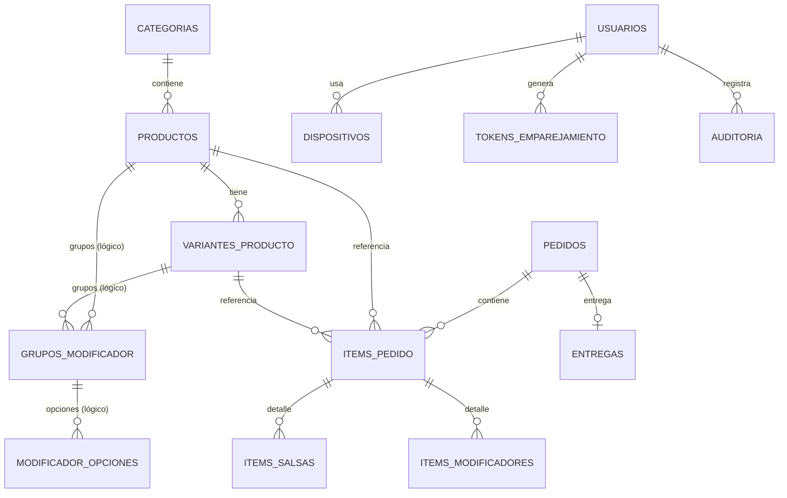

# Base de datos — Búfalo Server

Documentación completa de la base de datos local del servidor Android.

> Fuente de verdad del esquema: `app/schemas/com.example.bufaloserver.db.AppDatabaseServidor/17.json`.
> Código: `app/src/main/java/com/example/bufaloserver/db/`.

---

## 1. Resumen

| Dato | Valor |
|---|---|
| Motor | SQLite vía **Room 2.6.1** |
| Clase Room | `com.example.bufaloserver.db.AppDatabaseServidor` |
| Nombre del archivo | `bufaloserver.db` |
| Versión actual del esquema | **17** |
| `exportSchema` | `true` (JSON en `app/schemas/...`) |
| Entidades / tablas | **20** |
| DAOs registrados | **20** |
| Migraciones registradas | **16** (v1 → v17) |
| Migración destructiva | No (`fallbackToDestructiveMigration` no está activo) |
| Modo de journal | WAL (Room por defecto); la limpieza hace `wal_checkpoint(TRUNCATE)` |
| Pool de escritura | `AppDatabaseServidor.dbExecutor` → `Executors.newFixedThreadPool(4)` |
| Singleton | `AppDatabaseServidor.getInstance(context)` |

La base vive en el almacenamiento interno de la app:
`/data/data/com.example.bufaloserver/databases/bufaloserver.db` (más `-wal` y `-shm`).

---

## 2. Configuración y ciclo de vida

```java
public static AppDatabaseServidor getInstance(Context context) {
    // Room.databaseBuilder(context, AppDatabaseServidor.class, "bufaloserver.db")
    //   .addMigrations(MIGRATION_1_2 ... MIGRATION_16_17)
    //   .addCallback(SEED_CALLBACK)
    //   .build();
}
```

- **Singleton con doble chequeo** (`volatile`), una sola instancia por proceso.
- **`SEED_CALLBACK.onCreate`**: la primera vez que se crea el archivo, carga el menú inicial con `DatabaseSeeder.seed(db)` en un hilo del `dbExecutor`. No se ejecuta en cada arranque ni en migraciones.
- **`dbExecutor`**: pool fijo de 4 hilos, público y estático, usado por `ServidorHttp` para no bloquear el hilo de NanoHTTPD.
- **Sin `fallbackToDestructiveMigration`**: si falta una migración, la app falla en vez de borrar datos.
- Room activa `PRAGMA foreign_keys = ON`, por lo que las cascadas declaradas se aplican de verdad.

---

## 3. Convenciones del modelo

1. **IDs**: `long` autoincrementales (`INTEGER PRIMARY KEY AUTOINCREMENT`).
2. **Dinero**: siempre `INTEGER` en **centavos** (`precio_centavos`, `total_centavos`, `monto_centavos`, etc.). Nunca `REAL` para plata.
3. **Fechas**: `long` epoch en milisegundos (`creado_en`, `pagado_en`, `fecha`, `expira_en`...).
4. **Booleanos**: `INTEGER` 0/1 (`activo`, `impreso`, `recurrente`, `usado`...).
5. **Enums**: constantes `String` en las entidades, no enums de Room, para poder ampliarlos sin migración.
6. **Snapshots históricos**: los pedidos guardan nombre y precio del producto al momento de la venta (`nombre_snapshot`, `precio_centavos_snapshot`), para que editar el menú no altere el historial.
7. **Soft delete**: categorías, productos, salsas y usuarios se desactivan (`activo = 0`) en vez de borrarse.
8. **Idempotencia**: UUID generado por el cliente para reintentos seguros (`pedidos.uuid_cliente`, `gastos_generales.uuid_cliente`, `gastos_diarios.uuid_offline`).
9. **Atribución**: quién hizo cada acción se toma de la sesión del servidor, nunca del JSON del cliente (`usuario_creador_id`, `usuario_cobrador_id`, `usuario_id`, `auditoria`).

---

## 4. Relaciones principales



- Las relaciones con **FK real** son: `productos.categoria_id`, `variantes_producto.producto_id`, `items_pedido.pedido_id/producto_id/variante_id`, `items_salsas.item_pedido_id`, `items_modificadores.item_pedido_id` y `entregas.pedido_id`.
- Las relaciones con `usuario_id` son **lógicas** (no hay FK), para no bloquear el borrado/desactivación de usuarios.
- `grupos_modificador` y `modificador_opciones` también son lógicas: no tienen FK ni índices (ver hallazgos).

---

## 5. Tablas / entidades

Todas las tablas tienen `id INTEGER PRIMARY KEY AUTOINCREMENT NOT NULL` salvo que se indique lo contrario.

### 5.1 `categorias`

Categorías del menú.

| Columna | Tipo | Nulo | Default | Descripción |
|---|---|---|---|---|
| `id` | INTEGER | no | — | PK |
| `nombre` | TEXT | sí | — | Nombre visible |
| `emoji` | TEXT | sí | — | Emoji decorativo |
| `orden` | INTEGER | no | — | Orden en el menú |
| `activo` | INTEGER | no | — | 0 = oculta |
| `imprimir_en_cocina` | INTEGER | no | `1` | 0 = sus productos no salen en la comanda |

Entidad: `Categoria.java`. DAO: `CategoriaDao`.

---

### 5.2 `productos`

Productos del menú. Pueden tener variantes o no.

| Columna | Tipo | Nulo | Default | Descripción |
|---|---|---|---|---|
| `id` | INTEGER | no | — | PK |
| `categoria_id` | INTEGER | no | — | FK → `categorias.id` (`CASCADE`) |
| `nombre` | TEXT | sí | — | Nombre |
| `precio_centavos` | INTEGER | no | — | Precio base (0 si solo tiene variantes) |
| `es_pollo` | INTEGER | no | — | Muestra cantidad + salsas + bañado |
| `es_combo` | INTEGER | no | — | Muestra salsas |
| `es_salsas_modal` | INTEGER | no | — | Modal de salsas por unidad |
| `es_promo` | INTEGER | no | — | Aparece en promociones |
| `es_refresco` | INTEGER | no | — | Lógica de llevar/aquí |
| `tiene_salsas` | INTEGER | no | — | Ofrece salsas |
| `max_salsas` | INTEGER | no | `-1` | -1 = no ofrece, 0 = sin límite, N = límite |
| `tiene_inventario` | INTEGER | no | `0` | Control de stock (solo sin variantes) |
| `stock_actual` | INTEGER | no | `0` | Unidades disponibles |
| `stock_minimo` | INTEGER | no | `5` | Umbral de aviso |
| `stock_maximo` | INTEGER | no | `0` | 0 = máximo no definido |
| `tiene_variantes` | INTEGER | no | — | Flag de conveniencia |
| `etiqueta_caracteristica` | TEXT | sí | — | Ej. "Bañado" |
| `activo` | INTEGER | no | — | 0 = oculto |
| `creado_en` | INTEGER | no | — | Timestamp |

Índices: `index_productos_categoria_id (categoria_id)`.
FK: `categoria_id → categorias(id) ON DELETE CASCADE`.
Entidad: `Producto.java`. DAO: `ProductoDao`.

---

### 5.3 `variantes_producto`

Variantes de un producto (tamaños, presentaciones).

| Columna | Tipo | Nulo | Default | Descripción |
|---|---|---|---|---|
| `id` | INTEGER | no | — | PK |
| `producto_id` | INTEGER | no | — | FK → `productos.id` (`CASCADE`) |
| `label` | TEXT | sí | — | Ej. "6 und", "estándar" |
| `precio_centavos` | INTEGER | no | — | Precio |
| `habilitado` | INTEGER | no | — | 0 = "por definir" |
| `max_salsas` | INTEGER | no | — | Límite de salsas |
| `orden` | INTEGER | no | — | Orden |
| `tiene_caracteristica` | INTEGER | no | — | Ofrece bañado/extra |
| `etiqueta_caracteristica` | TEXT | sí | — | Etiqueta |
| `tiene_inventario` | INTEGER | no | `0` | Control de stock |
| `stock_actual` | INTEGER | no | `0` | Unidades |
| `stock_minimo` | INTEGER | no | `5` | Umbral |
| `stock_maximo` | INTEGER | no | `0` | 0 = no definido |

Índices: `index_variantes_producto_producto_id (producto_id)`.
FK: `producto_id → productos(id) ON DELETE CASCADE`.
Entidad: `VarianteProducto.java`. DAO: `VarianteProductoDao`.

---

### 5.4 `salsas_globales`

Catálogo global de salsas.

| Columna | Tipo | Nulo | Default |
|---|---|---|---|
| `id` | INTEGER | no | — |
| `nombre` | TEXT | sí | — |
| `orden` | INTEGER | no | — |
| `activo` | INTEGER | no | — |

Entidad: `SalsaGlobal.java`. DAO: `SalsaGlobalDao`.

---

### 5.5 `pedidos`

Cabecera de cada orden.

| Columna | Tipo | Nulo | Default | Descripción |
|---|---|---|---|---|
| `id` | INTEGER | no | — | PK |
| `numero_orden` | INTEGER | no | — | Número visible; lo asigna el servidor (reinicia cada mes, mínimo 100) |
| `nombre_cliente` | TEXT | sí | — | Cliente |
| `tipo` | TEXT | sí | — | `aqui`, `llevar`, `mixto` |
| `estado` | TEXT | sí | — | `pendiente`, `pagado`, `cancelado` |
| `metodo_pago` | TEXT | sí | — | `efectivo`, `tarjeta`, `qr`, `mixto`, `null` |
| `total_centavos` | INTEGER | no | — | Total |
| `descuento_centavos` | INTEGER | no | — | Descuento |
| `descuento_tipo` | TEXT | sí | — | `bs` o `pct` |
| `mixto_efectivo_centavos` | INTEGER | no | — | Parte efectivo del pago mixto |
| `mixto_tarjeta_centavos` | INTEGER | no | — | Parte tarjeta |
| `mixto_qr_centavos` | INTEGER | no | — | Parte QR |
| `creado_en` | INTEGER | no | — | Creación |
| `enviado_cocina_en` | INTEGER | sí | — | Envío a cocina |
| `pagado_en` | INTEGER | sí | — | Pago |
| `cancelado_en` | INTEGER | sí | — | Cancelación |
| `usuario_creador_id` | INTEGER | no | `0` | Quién tomó el pedido |
| `usuario_cobrador_id` | INTEGER | no | `0` | Quién cobró |
| `impreso` | INTEGER | no | `0` | Último intento de impresión exitoso |
| `intento_impresion_en` | INTEGER | sí | — | Reclamo atómico de impresión |
| `uuid_cliente` | TEXT | sí | — | Idempotencia de `POST /pedido` |

Entidad: `Pedido.java`. DAO: `PedidoDao`.

Reglas relevantes:
- `total` neto = `total_centavos - descuento_centavos`.
- `numero_orden` se calcula con `getMaxNumeroOrdenDesde(inicioDelMes)`, mínimo 100.
- La impresión usa un reclamo atómico en `intento_impresion_en` contra tickets duplicados.
- La cancelación solo afecta si `estado != 'cancelado'` (evita doble reversión de stock).

---

### 5.6 `items_pedido`

Líneas del pedido.

| Columna | Tipo | Nulo | Default | Descripción |
|---|---|---|---|---|
| `id` | INTEGER | no | — | PK |
| `pedido_id` | INTEGER | no | — | FK → `pedidos.id` (`CASCADE`) |
| `producto_id` | INTEGER | sí | — | FK → `productos.id` (`SET NULL`) |
| `variante_id` | INTEGER | sí | — | FK → `variantes_producto.id` (`SET NULL`) |
| `nombre_snapshot` | TEXT | sí | — | Nombre al momento de la venta |
| `precio_centavos_snapshot` | INTEGER | no | — | Precio unitario al momento |
| `cantidad` | INTEGER | no | — | Cantidad |
| `total_centavos` | INTEGER | no | — | Total de la línea |
| `banado` | INTEGER | no | — | Con bañado |
| `es_llevar` | INTEGER | no | — | Para llevar |
| `nota_cocina` | TEXT | sí | — | Nota |

Índices: `pedido_id`, `producto_id`, `variante_id`.
Entidad: `ItemPedido.java`. DAO: `ItemPedidoDao`.

---

### 5.7 `items_salsas`

Una fila por salsa elegida en una línea.

| Columna | Tipo | Nulo | Default |
|---|---|---|---|
| `id` | INTEGER | no | — |
| `item_pedido_id` | INTEGER | no | — |
| `nombre` | TEXT | sí | — |

Índice: `item_pedido_id`. FK: `item_pedido_id → items_pedido(id) ON DELETE CASCADE`.
Entidad: `ItemSalsa.java`. DAO: `ItemSalsaDao`.

---

### 5.8 `items_modificadores`

Una fila por modificador elegido (con o sin costo).

| Columna | Tipo | Nulo | Default |
|---|---|---|---|
| `id` | INTEGER | no | — |
| `item_pedido_id` | INTEGER | no | — |
| `nombre` | TEXT | sí | — |
| `precio_extra_centavos` | INTEGER | no | — |

Índice: `item_pedido_id`. FK: `item_pedido_id → items_pedido(id) ON DELETE CASCADE`.
Entidad: `ItemModificadorSeleccionado.java`. DAO: `ItemModificadorSeleccionadoDao`.

---

### 5.9 `entregas`

Tabla de entregas. **Actualmente sin uso** (ningún endpoint la lee/escribe).

| Columna | Tipo | Nulo | Default |
|---|---|---|---|
| `id` | INTEGER | no | — |
| `pedido_id` | INTEGER | no | — |
| `estado` | TEXT | sí | — |
| `metodo_pago_final` | TEXT | sí | — |
| `entregado_en` | INTEGER | sí | — |

Índice único: `pedido_id`. FK: `pedido_id → pedidos(id) ON DELETE CASCADE`.
Entidad: `Entrega.java`. DAO: `EntregaDao`.

---

### 5.10 `gastos_diarios`

Compras/gastos del día, incluidos los capturados sin conexión y los adelantos de sueldo.

| Columna | Tipo | Nulo | Default | Descripción |
|---|---|---|---|---|
| `id` | INTEGER | no | — | PK |
| `detalle` | TEXT | sí | — | Descripción |
| `monto_centavos` | INTEGER | no | — | Monto |
| `fecha` | INTEGER | no | — | Día (00:00) |
| `creado_en` | INTEGER | no | — | Timestamp real |
| `usuario_id` | INTEGER | no | `0` | Quién lo cargó (o empleado en adelanto) |
| `origen_offline` | INTEGER | no | `0` | Capturado sin login |
| `comprado_por` | TEXT | sí | — | Texto libre legacy |
| `uuid_offline` | TEXT | sí | — | Idempotencia de `/gastos/pendientes` |
| `es_adelanto` | INTEGER | no | `0` | Adelanto de sueldo |

Entidad: `GastoDiario.java`. DAO: `GastoDiarioDao`.

---

### 5.11 `gastos_generales`

Gastos mensuales/fijos. Cada fila es un registro independiente de un mes concreto.

| Columna | Tipo | Nulo | Default | Descripción |
|---|---|---|---|---|
| `id` | INTEGER | no | — | PK |
| `nombre` | TEXT | sí | — | Ej. "Alquiler", "Luz", "Sueldo Raúl" |
| `monto_centavos` | INTEGER | no | — | Monto de ese mes |
| `anio` | INTEGER | no | — | Año |
| `mes` | INTEGER | no | — | 1–12 |
| `recurrente` | INTEGER | no | `1` | 1 = se repite cada mes |
| `usuario_id` | INTEGER | no | `0` | Empleado vinculado (sueldo) |
| `creado_en` | INTEGER | no | — | Timestamp |
| `uuid_cliente` | TEXT | sí | — | Idempotencia de `POST /gastos-generales` |

Entidad: `GastoGeneral.java`. DAO: `GastoGeneralDao`.

Regla de visibilidad (`getVisiblesEnMes`):
- Recurrentes: la última fila registrada de cada `nombre` hasta el mes consultado (puede mostrarse como "pendiente" si es de un mes anterior).
- No recurrentes: solo si coinciden `anio` y `mes`.

---

### 5.12 `grupos_modificador`

Grupos de modificadores (ej. "Complementos", "Extras"). Cuelgan de una variante **o** de un producto sin variantes.

| Columna | Tipo | Nulo | Default | Descripción |
|---|---|---|---|---|
| `id` | INTEGER | no | — | PK |
| `varianteId` | INTEGER | no | — | Variante dueña (0 si es de producto) |
| `productoId` | INTEGER | no | — | Producto dueño (0 si es de variante) |
| `nombre` | TEXT | sí | — | Nombre del grupo |
| `multiSeleccion` | INTEGER | no | — | Permite varias opciones |
| `orden` | INTEGER | no | — | Orden |

Entidad: `GrupoModificador.java`. DAO: `GrupoModificadorDao`.
Sin FK ni índice (ver hallazgos).

---

### 5.13 `modificador_opciones`

Opciones dentro de un grupo.

| Columna | Tipo | Nulo | Default | Descripción |
|---|---|---|---|---|
| `id` | INTEGER | no | — | PK |
| `grupoId` | INTEGER | no | — | Grupo padre |
| `nombre` | TEXT | sí | — | Ej. "Con arroz" |
| `precio_extra_centavos` | INTEGER | no | `0` | Extra (0 = sin costo) |
| `orden` | INTEGER | no | — | Orden |

Entidad: `ModificadorOpcion.java`. DAO: `ModificadorOpcionDao`.
Sin FK ni índice (ver hallazgos).

---

### 5.14 `items_variante`

Sistema viejo de stock por lote. **Reemplazado** por `VarianteProducto.tiene_inventario/stock_actual`; la tabla sigue existiendo pero no se usa.

| Columna | Tipo | Nulo | Default |
|---|---|---|---|
| `id` | INTEGER | no | — |
| `varianteId` | INTEGER | no | — |
| `nombre` | TEXT | sí | — |
| `stockActual` | INTEGER | no | — |
| `stockInicial` | INTEGER | no | — |

Entidad: `ItemVariante.java`. DAO: `ItemVarianteDao`.
Sin FK ni índice (ver hallazgos).

---

### 5.15 `usuarios`

Empleados que pueden iniciar sesión.

| Columna | Tipo | Nulo | Default | Descripción |
|---|---|---|---|---|
| `id` | INTEGER | no | — | PK |
| `nombre` | TEXT | sí | — | Nombre |
| `pin_hash` | TEXT | sí | — | PBKDF2 del PIN |
| `pin_salt` | TEXT | sí | — | Sal por usuario |
| `rol` | TEXT | sí | — | `mesero`, `cajero`, `administrador` |
| `activo` | INTEGER | no | `1` | Puede loguearse |
| `creado_en` | INTEGER | no | `0` | Timestamp |

**Nunca se guarda el PIN en texto plano.** Detalle en la sección de seguridad.
Entidad: `Usuario.java`. DAO: `UsuarioDao`.

---

### 5.16 `movimientos_inventario`

Historial de entradas, salidas, ventas, ajustes y devoluciones de stock.

| Columna | Tipo | Nulo | Default | Descripción |
|---|---|---|---|---|
| `id` | INTEGER | no | — | PK |
| `producto_id` | INTEGER | sí | — | Producto afectado |
| `variante_id` | INTEGER | sí | — | Variante afectada |
| `tipo` | TEXT | sí | — | `entrada`, `salida`, `venta`, `ajuste`, `devolucion` |
| `cantidad` | INTEGER | no | — | Unidades |
| `stock_resultante` | INTEGER | no | — | Stock después del movimiento |
| `motivo` | TEXT | sí | — | Texto libre |
| `nombre_snapshot` | TEXT | sí | — | Nombre al momento |
| `creado_en` | INTEGER | no | — | Timestamp |
| `usuario_id` | INTEGER | no | `0` | Quién lo hizo |

Índices: `producto_id`, `variante_id`.
Entidad: `MovimientoInventario.java`. DAO: `MovimientoInventarioDao`.
Exactamente uno de `producto_id`/`variante_id` está seteado.

---

### 5.17 `dispositivos`

Dispositivos autorizados (1 dispositivo = 1 empleado fijo).

| Columna | Tipo | Nulo | Default | Descripción |
|---|---|---|---|---|
| `id` | INTEGER | no | — | PK |
| `deviceToken` | TEXT | sí | — | Secreto generado por el servidor |
| `usuarioId` | INTEGER | no | — | Empleado dueño |
| `nombre` | TEXT | no | `''` | Ej. "Celular de Juan" |
| `estado` | TEXT | no | `'autorizado'` | `autorizado` / `revocado` |
| `creado_en` | INTEGER | no | `0` | Timestamp |
| `ultimo_uso_en` | INTEGER | no | `0` | Último login/uso |

Índice único: `deviceToken`.
Entidad: `Dispositivo.java`. DAO: `DispositivoDao`.

---

### 5.18 `tokens_emparejamiento`

Códigos de un solo uso para el QR de emparejamiento.

| Columna | Tipo | Nulo | Default | Descripción |
|---|---|---|---|---|
| `id` | INTEGER | no | — | PK |
| `token` | TEXT | sí | — | Código del QR |
| `usuarioId` | INTEGER | no | — | Usuario a asociar |
| `creado_en` | INTEGER | no | `0` | Timestamp |
| `expira_en` | INTEGER | no | `0` | Vencimiento |
| `usado` | INTEGER | no | `0` | 1 = consumido |

Índice único: `token`. Vigencia: **5 minutos** (`EXPIRA_MS`).
El consumo es atómico: `UPDATE ... WHERE usado = 0 AND expira_en > ahora`.
Entidad: `TokenEmparejamiento.java`. DAO: `TokenEmparejamientoDao`.

---

### 5.19 `auditoria`

Log de acciones sensibles.

| Columna | Tipo | Nulo | Default | Descripción |
|---|---|---|---|---|
| `id` | INTEGER | no | — | PK |
| `usuario_id` | INTEGER | no | — | Autor |
| `nombre_usuario` | TEXT | sí | — | Snapshot del nombre |
| `rol` | TEXT | sí | — | Snapshot del rol |
| `accion` | TEXT | sí | — | Constante `ACCION_*` |
| `detalle` | TEXT | sí | — | Texto legible |
| `entidad_tipo` | TEXT | no | `''` | `pedido`, `gasto_diario`, `gasto_general`, `limpieza`... |
| `entidad_id` | INTEGER | no | `0` | ID afectado |
| `creado_en` | INTEGER | no | — | Timestamp |

Índices: `creado_en`, `usuario_id`.
Acciones: cancelar pedido, crear/editar/eliminar gastos, crear/editar/eliminar gastos generales, imprimir resumen del día y limpieza de datos.
Entidad: `Auditoria.java`. DAO: `AuditoriaDao`.

---

### 5.20 `resumen_mensual`

Totales históricos que sobreviven a la limpieza de datos.

| Columna | Tipo | Nulo | Default |
|---|---|---|---|
| `id` | INTEGER | no | — |
| `anio` | INTEGER | no | — |
| `mes` | INTEGER | no | — |
| `ventas_centavos` | INTEGER | no | — |
| `pedidos_pagados` | INTEGER | no | — |
| `pedidos_cancelados` | INTEGER | no | — |
| `descuentos_centavos` | INTEGER | no | — |
| `efectivo_centavos` | INTEGER | no | — |
| `tarjeta_centavos` | INTEGER | no | — |
| `qr_centavos` | INTEGER | no | — |
| `gastos_diarios_centavos` | INTEGER | no | — |
| `gastos_fijos_centavos` | INTEGER | no | — |
| `creado_en` | INTEGER | no | — |

Índice único: `(anio, mes)`.
Se inserta con `OnConflictStrategy.IGNORE`: un resumen guardado **nunca se sobrescribe**.
Entidad: `ResumenMensual.java`. DAO: `ResumenMensualDao`.

---

## 6. DAOs registrados

`AppDatabaseServidor` expone 20 DAOs:

| DAO | Uso principal |
|---|---|
| `CategoriaDao` | CRUD de categorías, activar/ordenar, imprimir en cocina |
| `ProductoDao` | CRUD, precio, activar, inventario y descuento atómico de stock |
| `VarianteProductoDao` | CRUD, precios, salsas, inventario y descuento atómico |
| `SalsaGlobalDao` | Catálogo de salsas |
| `PedidoDao` | Alta, cancelación condicional, rangos, totales, impresión, limpieza |
| `ItemPedidoDao` | Líneas de pedido |
| `ItemSalsaDao` | Salsas por línea |
| `ItemModificadorSeleccionadoDao` | Modificadores por línea |
| `EntregaDao` | Entregas (sin uso) |
| `GastoDiarioDao` | Gastos diarios, suma por fecha, idempotencia offline |
| `GastoGeneralDao` | Gastos mensuales, visibilidad recurrente, idempotencia |
| `GrupoModificadorDao` | Grupos por variante/producto |
| `ModificadorOpcionDao` | Opciones por grupo |
| `ItemVarianteDao` | Stock legacy |
| `UsuarioDao` | Usuarios, activar, primer usuario |
| `MovimientoInventarioDao` | Historial de stock |
| `DispositivoDao` | Dispositivos autorizados |
| `TokenEmparejamientoDao` | Tokens de un solo uso |
| `AuditoriaDao` | Log de acciones |
| `ResumenMensualDao` | Resúmenes y cálculos mensuales |

> `EstadisticasDao` existe en disco pero **no está registrado** en `@Database`; Room no lo genera. Es código muerto (ver hallazgos).

### Operaciones atómicas destacadas

- `ProductoDao.descontarStockSiAlcanza(id, cantidad)`:
  `UPDATE ... SET stock_actual = stock_actual - :cantidad WHERE ... stock_actual >= :cantidad`
  Devuelve 0 si no alcanza; el llamador rechaza la venta.
- `VarianteProductoDao.descontarStockSiAlcanza(...)`: igual, por variante.
- `PedidoDao.reservarParaImprimirAutomatico(...)`: reclamo atómico contra tickets duplicados.
- `TokenEmparejamientoDao.reclamarSiValido(...)`: consumo atómico del QR.
- `PedidoDao.cancelar(...)`: solo cancela si `estado != 'cancelado'`.
- `GastoGeneralDao.getVisiblesEnMes(...)`: resuelve el "molde" recurrente por nombre.

---

## 7. Migraciones (v1 → v17)

Todas están definidas en `AppDatabaseServidor.java` y registradas en `getInstance()`.

| Migración | Cambio | Tipo |
|---|---|---|
| `MIGRATION_1_2` | `modificador_opciones.precioExtra` de INTEGER a REAL | Recrea tabla + copia |
| `MIGRATION_2_3` | `gastos_fijos.recurrente` | `ADD COLUMN` |
| `MIGRATION_3_4` | Crea `movimientos_inventario` + 2 índices | Tabla nueva |
| `MIGRATION_4_5` | Crea `dispositivos` y `tokens_emparejamiento` + únicos | Tablas nuevas |
| `MIGRATION_5_6` | `pedidos.impreso` default 0 | `ADD COLUMN` |
| `MIGRATION_6_7` | Crea `auditoria` + 2 índices | Tabla nueva |
| `MIGRATION_7_8` | Elimina tablas `insumos` e `insumos_compras` | `DROP TABLE` |
| `MIGRATION_8_9` | Crea `gastos_generales`, migra `gastos_fijos` + pagos, borra ambas, agrega `gastos_diarios.es_adelanto` | Reestructura |
| `MIGRATION_9_10` | `pedidos.intento_impresion_en` | `ADD COLUMN` |
| `MIGRATION_10_11` | `pedidos.uuid_cliente` + índice único **parcial** | `ADD COLUMN` + índice |
| `MIGRATION_11_12` | `modificador_opciones` → `precio_extra_centavos` (convierte `ROUND(precio*100)`) | Recrea tabla + copia |
| `MIGRATION_12_13` | `usuarios.pin` → `pin_hash` + `pin_salt` (hash en Java con `PinHasher`) | Recrea tabla + copia |
| `MIGRATION_13_14` | `gastos_generales.uuid_cliente` + índice único **parcial** | `ADD COLUMN` + índice |
| `MIGRATION_14_15` | `categorias.imprimir_en_cocina` default 1 | `ADD COLUMN` |
| `MIGRATION_15_16` | `stock_maximo` en `productos` y `variantes_producto` default 0 | `ADD COLUMN` |
| `MIGRATION_16_17` | Crea `resumen_mensual` + índice único `(anio, mes)` | Tabla nueva |

Notas:
- Las migraciones que recrean tablas (`1_2`, `11_12`, `12_13`) usan el patrón "tabla nueva + copiar + DROP + RENAME" porque SQLite no permite `ALTER COLUMN` (y `DROP COLUMN` no es asumible en Android viejos).
- `12_13` es la única que lee filas con `Cursor` y calcula el hash en Java.
- La cadena completa está registrada linealmente, aunque en el archivo el orden de definición no sea ascendente.

---

## 8. Schemas exportados

Directorio:
`app/schemas/com.example.bufaloserver.db.AppDatabaseServidor/`

| Archivo | Estado |
|---|---|
| `1.json` – `11.json` | **No existen** (exportSchema se activó en v12) |
| `12.json` | Sí |
| `13.json` | **No existe** |
| `14.json` | Sí |
| `15.json` | Sí |
| `16.json` | Sí |
| `17.json` | Sí (esquema actual) |

El JSON contiene `createSql`, columnas, defaults, PK, índices, FKs e `identityHash`. Es lo que usa `MigrationTestHelper` para validar migraciones en tests instrumentados.

---

## 9. Datos iniciales (seed)

`DatabaseSeeder.seed()` carga el menú la primera vez que se crea la base. No es transaccional y corre asíncrono.

### Salsas (10)

Brava, Tabasco, Buffalo, Barbacoa picante, Barbacoa, Miel y mostaza, Albahaca, Blue cheese, Ajo parmesano, Buffalo / Barbacoa / Blue cheese.

### Categorías y productos

| Categoría | Producto | Precio / variantes |
|---|---|---|
| Pollo 🍗 | Fingers | 4 und 2800 · 6 und 3100 · 8 und 4000 · 10 und 4700 · 12/18/24 und "por definir" |
| Pollo 🍗 | Alas | 4 und 2700 · 6 und 3000 · 8 und 3800 · 10 und 4700 · 12 und 6000 · 18 und 9100 · 24 und 11800 |
| Pollo 🍗 | Pollo Broaster | 2300 |
| Extras 🍟 | Porción de Papas | 1400 |
| Extras 🍟 | Salsas | 400 c/u (`esSalsasModal`) |
| Extras 🍟 | Tocino | 500 |
| Hamburguesas 🍔 | Tradicional | 2500 |
| Hamburguesas 🍔 | Búfalo | 3000 |
| Hamburguesas 🍔 | Chesse Extreme | 3200 |
| Hamburguesas 🍔 | Mexicana | 3500 |
| Hamburguesas 🍔 | Salchiburger | 3300 |
| Hamburguesas 🍔 | Interminable | 4000 |
| Combos 🥡 | Combo Búfalo | 4000 (variante estándar) |
| Combos 🥡 | Combo Dúo | 8000 (variante estándar) |
| Combos 🥡 | Combo Dúo Extremo | 8500 (variante estándar) |
| Salchipapa 🍟 | Salchipapa | 2300 |
| Salchipapa 🍟 | Pipocas de Pollo | 2500 |
| Salchipapa 🍟 | Salchi Carne | 3200 |
| Salchipapa 🍟 | Salchi-Extreme | 3600 |
| Refrescos 🥤 | Coca-Cola 1L / Personal | 700 / 250 |
| Refrescos 🥤 | Pepsi 1L / Personal | 700 / 250 |
| Refrescos 🥤 | Sprite 1L / Personal | 700 / 250 |
| Refrescos 🥤 | Agua 600ml | 300 |

Los refrescos se insertan con `es_refresco = true`. No se cargan usuarios en el seed: el primer administrador se crea desde `EstadoServidorActivity.verificarPrimerAdmin()`.

---

## 10. Limpieza de datos

Clase: `com.example.bufaloserver.servicio.LimpiezaDatos`.

### Regla de retención

- Se conserva el **mes actual + 2 anteriores** (`MESES_A_CONSERVAR = 3`).
- Corte: día 1 del mes `actual - 2` a las 00:00, hora del dispositivo.

### Qué hace

1. Calcula y guarda un `ResumenMensual` por cada mes anterior al corte con actividad y sin resumen previo.
2. Borra:
   - Pedidos **cerrados** (`pagado`/`cancelado`) anteriores al corte. Por CASCADE se borran sus ítems, salsas, modificadores y entregas.
   - `gastos_diarios`, `movimientos_inventario`, `auditoria` y `tokens_emparejamiento` vencidos anteriores al corte.
3. Registra una fila de auditoría de la limpieza.
4. Ejecuta `VACUUM` fuera de la transacción si hay espacio libre suficiente.

### Qué NO toca nunca

- `gastos_generales` (los recurrentes usan la fila más reciente como molde).
- `productos`, `variantes_producto`, `categorias`, `usuarios`, `dispositivos`.
- Pedidos pendientes o en estados distintos de pagado/cancelado.

### Seguridad de ejecución

- Resúmenes + borrado + auditoría van en **una sola transacción**.
- Un resumen ya guardado no se sobrescribe.
- `AtomicBoolean` impide dos limpiezas simultáneas.
- La primera limpieza siempre es manual.
- La automática (cada hora desde `ServidorService`) solo corre si ya hubo una manual y:
  - no hubo actividad de pedidos en 45 minutos, **o**
  - pasaron más de 35 días desde la última limpieza.

---

## 11. Seguridad de datos

- **PIN**: `PBKDF2WithHmacSHA256`, clave de 256 bits, sal aleatoria de 16 bytes por usuario.
  - Iteraciones actuales: **10.000**.
  - Hashes legacy sin prefijo: se verifican con **120.000** iteraciones.
  - Formato guardado: `<iteraciones>$<base64>`.
  - Nunca se guarda el PIN en claro; no hay recuperación, solo verificación.
- **Sesiones**: viven en memoria (`SESIONES` en `ServidorHttp`), no en la base. Al reiniciar el servidor todos vuelven a loguearse.
- **Dispositivos**: `deviceToken` único generado con `SecureRandom` (32 bytes en Base64). Revocar un dispositivo invalida sus sesiones.
- **Emparejamiento**: token de un solo uso, vence a los 5 minutos, consumo atómico.
- **Auditoría**: snapshot de nombre y rol para que el log siga siendo legible aunque el usuario cambie después.
- **Borrado lógico**: usuarios desactivados (`activo = 0`) para no perder histórico.

---

## 12. Quién escribe en la base

| Componente | Escrituras |
|---|---|
| `ServidorHttp` | Pedidos, ítems, salsas, modificadores, gastos, inventario, usuarios, dispositivos, auditoría |
| `DatabaseSeeder` | Catálogo inicial (solo en `onCreate`) |
| `LimpiezaDatos` | Resúmenes, borrado de históricos, auditoría de limpieza |
| `EstadoServidorActivity` | Primer administrador |
| `ServidorService` | Dispara la limpieza automática |

Lecturas: el propio servidor HTTP, la pantalla de estado y los reportes (resumen, caja, inventario, ventas del día).

---

## 13. Cómo inspeccionar la base

Con un dispositivo/emulador depurable conectado:

```bash
adb exec-out run-as com.example.bufaloserver cat databases/bufaloserver.db > bufaloserver.db
adb exec-out run-as com.example.bufaloserver cat databases/bufaloserver.db-wal > bufaloserver.db-wal
sqlite3 bufaloserver.db
```

Comandos útiles dentro de `sqlite3`:

```sql
.tables
.schema pedidos
PRAGMA user_version;
PRAGMA foreign_key_check;
PRAGMA integrity_check;
SELECT COUNT(*) FROM pedidos;
```

También existe el dump en la pantalla "Estadísticas y Base de Datos" del cliente, respaldado por `EstadisticasDao` (aunque ese DAO hoy no está registrado en Room).

---

## 14. Hallazgos de la revisión

### Críticos

1. **Desfase de índices entre migraciones y entidades.**
   - `MIGRATION_10_11` crea `index_pedidos_uuid_cliente`, pero `Pedido` no declara `@Index`.
   - `MIGRATION_13_14` crea `index_gastos_generales_uuid_cliente`, pero `GastoGeneral` no declara `@Index`.
   - Room compara el set de índices al validar la migración. Una base v13 que actualiza a v14 falla con `Migration didn't properly handle: gastos_generales(...)`.
   - En instalaciones nuevas los índices no se crean, así que la idempotencia a nivel de base no existe.
   - **Fix sugerido:** declarar `@Index(value = "uuid_cliente", unique = true)` en ambas entidades y agregar una migración v17 → v18 con `CREATE UNIQUE INDEX IF NOT EXISTS`. El `WHERE ... IS NOT NULL` no es necesario: SQLite ya permite múltiples `NULL` en un índice único.

2. **`PedidoDao.insert` usa `OnConflictStrategy.REPLACE`** (`PedidoDao.java:20`).
   - Con el índice único, un duplicado de `uuid_cliente` no lanza `SQLiteConstraintException`: hace `INSERT OR REPLACE`, borra el pedido ganador (y sus ítems por CASCADE) y crea otro.
   - El `catch (SQLiteConstraintException)` de `ServidorHttp.crearPedido` queda sin efecto.
   - **Fix sugerido:** usar la estrategia por defecto (`ABORT`).

3. **`gastos_diarios.uuid_offline` no tiene índice único** (`GastoDiario.java:59`).
   - La idempotencia de `/gastos/pendientes` es `SELECT` + `INSERT`, vulnerable a duplicados en paralelo.
   - **Fix sugerido:** índice único sobre `uuid_offline`.

### Medios

4. **`MIGRATION_8_9` usa `strftime` sin `'localtime'`** (`AppDatabaseServidor.java:323-324`). Un gasto creado al final del mes en UTC-4 puede migrarse al mes siguiente.
5. **`grupos_modificador`, `modificador_opciones` e `items_variante` sin FK ni índices.** Riesgo de huérfanos y consultas con scan completo.
6. **Seed no transaccional y asíncrono** (`AppDatabaseServidor.java:561-571`). Un cierre a mitad deja el menú incompleto sin reintento.
7. **`gastos_generales` sin unicidad `(nombre, anio, mes)`.** Un doble toque puede duplicar el gasto y sumarlo dos veces en los reportes.
8. **Código muerto:** `EstadisticasDao` no registrado (y su consulta de gastos fijos usa `creado_en` en vez de `anio/mes`); `Entrega` e `ItemVariante` sin uso.
9. **Faltan índices de rango** en `pedidos.creado_en/pagado_en/cancelado_en`, `gastos_diarios.fecha` y `gastos_generales(anio, mes)`.
10. **Sin tests de migración y sin schemas 1–11 ni 13.** `room-testing` está declarado pero solo hay tests de ejemplo.

---

## 15. Recomendaciones / próximos pasos

1. Corregir el desfase de índices (entidades + migración 17→18).
2. Cambiar `PedidoDao.insert` a `ABORT`.
3. Agregar índice único a `gastos_diarios.uuid_offline`.
4. Corregir `strftime` en `MIGRATION_8_9` para futuras migraciones (la histórica ya no se puede cambiar sin afectar equipos que ya migraron).
5. Agregar índices a grupos/opciones y a las columnas de rango más consultadas.
6. Hacer el seed transaccional y con reintento.
7. Evaluar unicidad `(nombre, anio, mes)` en `gastos_generales`.
8. Registrar o eliminar `EstadisticasDao`; decidir si se borran `entregas` e `items_variante`.
9. Escribir tests instrumentados con `MigrationTestHelper` para la cadena 12→17 y las futuras.
10. Versionar los JSON de schema que falten cuando se toque cada versión.

---

## 16. Mapa rápido de archivos

| Archivo | Contenido |
|---|---|
| `db/AppDatabaseServidor.java` | `@Database`, singleton, migraciones, callback de seed |
| `db/DatabaseSeeder.java` | Menú inicial |
| `db/entities/*.java` | 20 entidades |
| `db/dao/*.java` | 20 DAOs registrados + `EstadisticasDao` sin registrar |
| `servicio/LimpiezaDatos.java` | Retención, resúmenes y borrado |
| `seguridad/PinHasher.java` | Hash/verificación de PIN |
| `http/ServidorHttp.java` | Uso principal de los DAOs |
| `app/schemas/.../17.json` | Esquema actual exportado |
